**Jam. Build. Drag. Done.**

Progrezzor is a very easy MIDI chord tool. Jam on the pads, find a progression you like, and drag it into your DAW as MIDI. You do not need to know any music theory.

## The screen

Everything is on one screen, with no tabs. The top row sets up the key and the sound. The big pads in the middle are your chords. The bar at the bottom holds your progression.

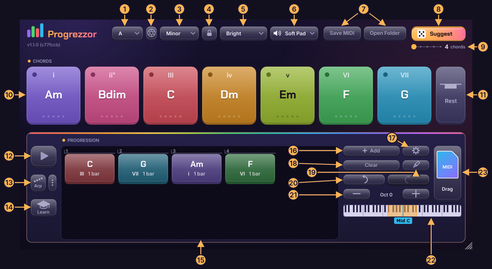

1. **Key** (the note name). Pick the key you want.
2. **Chord wheel.** Opens a circle that shows how the chords relate.
3. **Scale.** Major, Minor, Dorian, Phrygian, Mixolydian or Lydian.
4. **Lock to scale** (padlock). On means only chords that fit the key.
5. **Mood.** Eight moods that shape what Suggest gives you.
6. **Sound.** The built-in preview sound, or Off.
7. **Save MIDI** and **Open Folder.** Save the progression as a MIDI file, and open the folder it lands in.
8. **Suggest.** One click gives you a whole progression.
9. **Chords slider.** How many chords Suggest makes, from 4 to 8.
10. **Seven pads.** The chords of your key. The small Roman numeral shows the chord's place in the key.
11. **Rest.** The blank pad is a pause.
12. **Play.** Plays the progression.
13. **Arp** and its three dots. Plays chords one note at a time, or as a rhythm.
14. **Learn.** Practise the chords on a MIDI keyboard.
15. **Progression bar.** Your chords as coloured blocks.
16. **Add.** Every chord you play is added to the bar.
17. **Settings** (gear).
18. **Clear.** Empties the whole bar. Undo brings it back.
19. **Quick-text** (pencil). Type the chords instead of dragging.
20. **Undo** and **Redo.** They work everywhere.
21. **Oct − / +.** Move everything up or down by octaves.
22. **Mini keyboard.** Shows where the chords sound. The blue line is middle C.
23. **MIDI tile.** Drag it into your DAW.

Small controls (the gear on a pad, the padlock on a block) appear when you point at the pad or block. Tooltips explain every button. You can turn them off in Settings.

## Quick start

1. Put Progrezzor on a MIDI track with a synth after it (see [Into your DAW](#into-your-daw)). Or just use the built-in sound.
2. Click the big pads, or play the white keys on a MIDI keyboard. Every pad is a chord that fits the key.
3. Press **Suggest** for a whole progression, or drag pads down into the bar to build your own.
4. Press **Play** (or start your DAW) to hear it loop.
5. Drag the **MIDI** tile into your DAW. Done.

The first click on a pad makes a sound with no routing or setup. The plugin starts in C Major with the mood Bright.

## Pads

The seven big pads are the chords of the current key and scale. Each has its own colour. The big text is the chord name, and the small Roman numeral is its place in the key (capital letters are major, small letters are minor). Click a pad with the mouse, or hit it with a MIDI keyboard: it lights up while it plays.

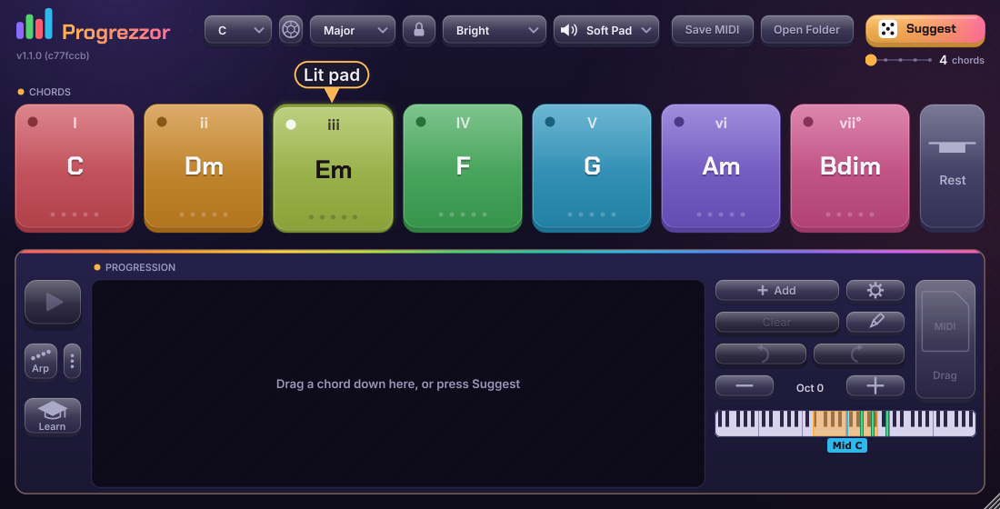

MIDI keys light up pads too, and the mini keyboard shows the notes (green).

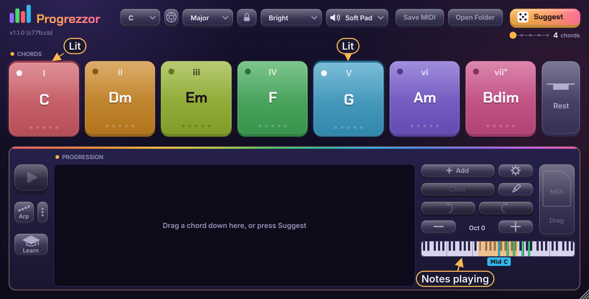

### Play from a MIDI keyboard

The white keys play pad 1 to 7 (C to B) in every octave. Black keys do nothing. How hard you hit the key sets how loud the chord is. In Settings you can switch to **Chord roots**: then a key plays the pad whose chord starts on that note, black keys included. Keys that have no pad do nothing.

### Other kinds of the same chord

Point at a pad and a small gear appears. It opens a menu with other kinds of that chord (7, maj7, sus, add9 and more) and inversions. With Lock to scale on, you see only the ones that fit the key. The last item, *More chords outside the key...*, switches the lock off and shows them all.

### Rest

The blank pad on the right is a pause. It makes no sound. Drag it into the bar to put a rest there. See [The progression bar](#the-progression-bar).

## Key, scale, lock and mood

Pick a key and a scale at the top. All seven pads change at once, and so does the progression: chords in the bar move with the key, so your progression keeps its sound. You cannot change the key while the progression is playing.

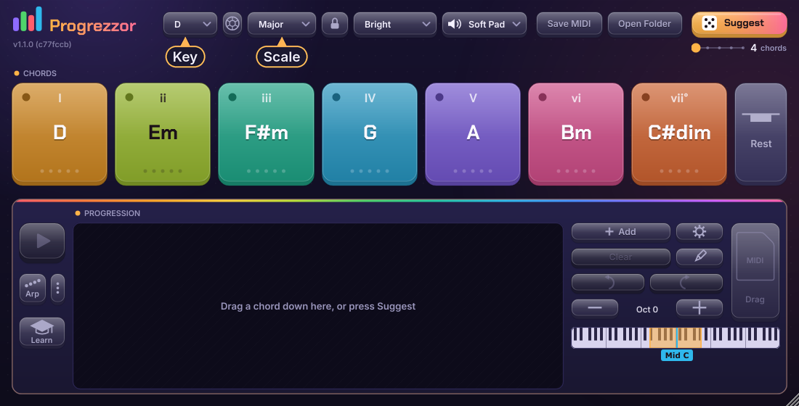

Names are spelled to fit the key (Bb, not A#).

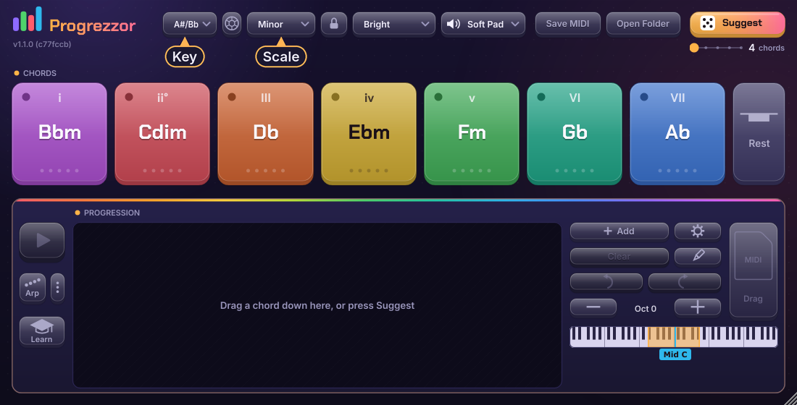

### Lock to scale

The padlock is on from the start. With it on, the pads, Suggest and the chord menus stay in the key. Progrezzor never changes a chord on its own. If a chord does not fit the key (for example after you change key), the block gets a red dashed edge and is silent until you allow it.

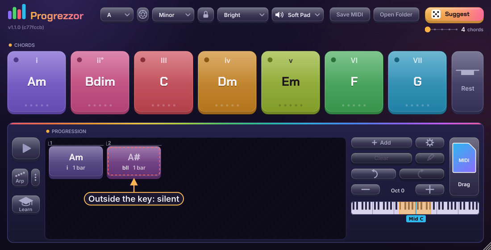

### Mood

Mood sets the feeling Suggest aims for. It never changes the key, the scale or the sound.

| Mood | What it sounds like |
| --- | --- |
| Bright | Happy and open, plain chords. |
| Warm | Safe and soft. |
| Dreamy | Floating. |
| Melancholic | Sad and beautiful. |
| Dark | Heavy and tense, close to the home chord. |
| Deep | Hypnotic and roomy. |
| Driving | Forward and energetic. |
| Soulful | Rich and warm. |

## Suggest

Press **Suggest** and a whole progression appears in the bar. Press it again for another one. It follows the key, scale and mood you chose. Some suggestions use an inversion, shown with a slash (G/B), when it makes the bass line walk nicely.

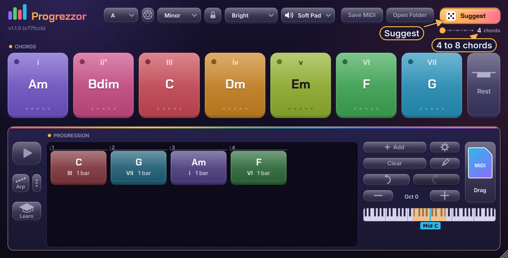

- **How many chords.** The slider under Suggest goes from 4 to 8. It is saved with the project.
- **Keep the good ones.** A block with a padlock stays when you press Suggest again. The rest is replaced.
- **It asks first.** If the bar holds chords you made yourself, a small card asks "Replace the chords in the bar?" Press Replace to go on, or Cancel. Undo always works.
- Suggest never adds rests. A rest without a padlock is replaced like any other block.

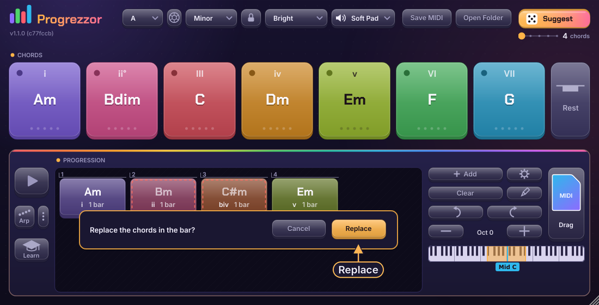

## The progression bar

The bar is your progression: coloured blocks in a row. A block is one chord. A small number above each block shows where it starts. Every block starts as one bar long. The blocks wrap onto more rows when there are many.

### Add a chord

Drag a pad down into the bar. Drop it between blocks, or at the edge of a block, to insert it. Drop it on the middle of a block to replace that block (it lights up). A plain click on a pad never replaces anything.

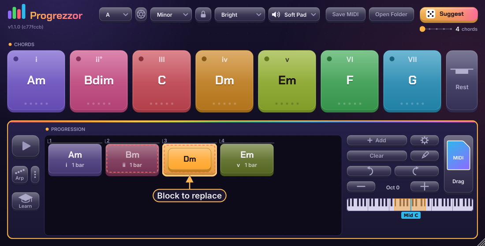

### Change the length

Drag the right edge of a block. It moves in steps of half a bar, from half a bar up to 8 bars. The progression can have any total length, even an odd number of bars.

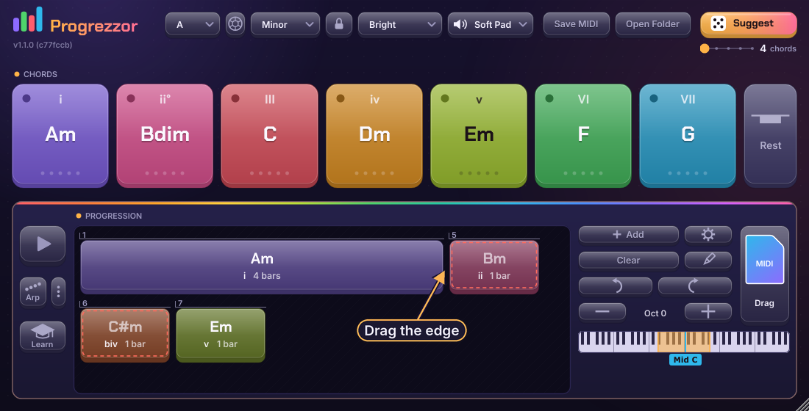

### Move, copy and delete

- **Move.** Drag a block to a new place.
- **Copy.** Hold `Ctrl` (`Option` on Mac) while you drag.
- **Delete.** Click a block to mark it, then press `Delete`. Or use the block menu.
- **Undo and Redo.** The two arrows. Every change is one step. **Clear** empties the whole bar, and Undo brings it back in one step.

### The block menu

Right-click a block, or point at it and use the small gear at its lower left. The menu has the chord kind, inversion, Octave up and down, length (½, 1, 2 or 4 bars), Lock, Duplicate and Delete at the bottom. A change only affects that block, never the pad. Right-click never deletes by itself.

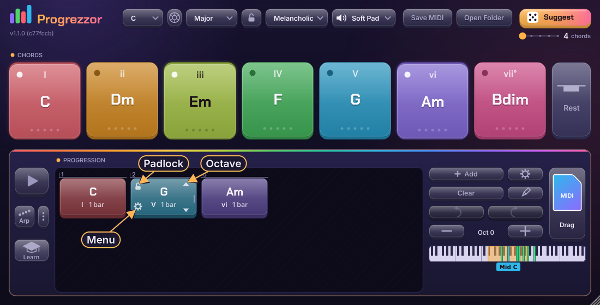

### Lock a block

The padlock on a block keeps it in place when you press Suggest. A locked block shows a closed padlock.

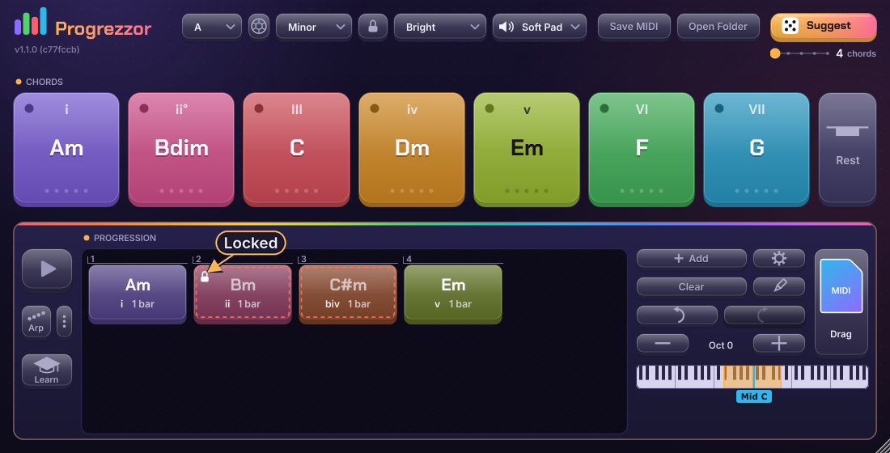

### Octaves

The small arrows on a block lift or lower that chord by an octave. The block then shows +1 oct or −1 oct. The **Oct − / +** buttons move everything at once (pads, progression and MIDI file) by up to two octaves.

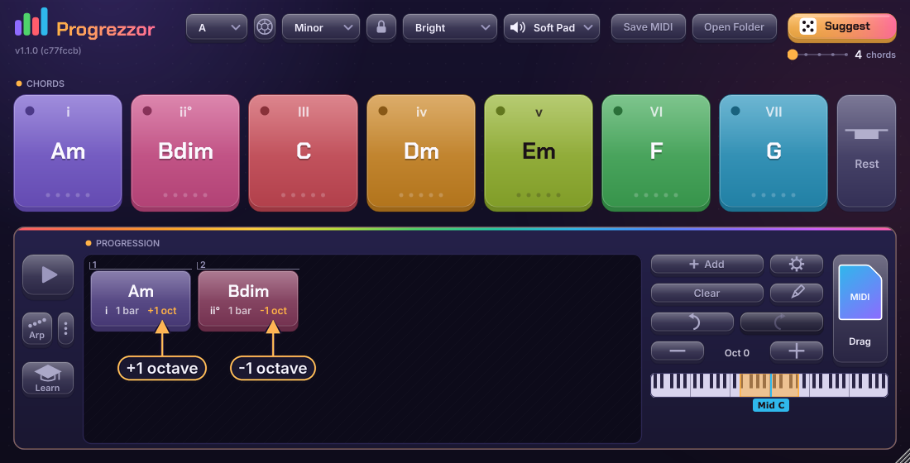

### Rests

Drag the blank Rest pad into the bar. Between blocks it adds a one-bar pause. On the middle of a block it turns that block into a pause of the same length. Drop a chord on a pause and it becomes a chord again. A rest is grey and faint until you point at it, and it shows the music symbol for its length. It can be moved, copied, locked, deleted and stretched like any block.

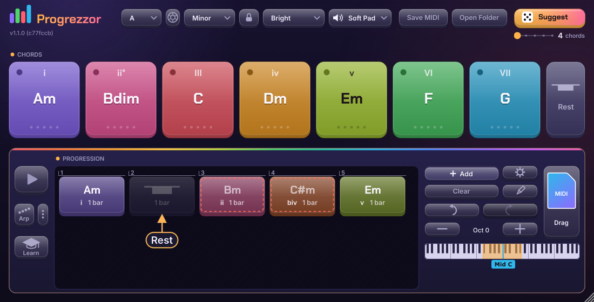

The symbols for ½ bar, 1 bar, 1½ bars, 2 bars and 3 bars:

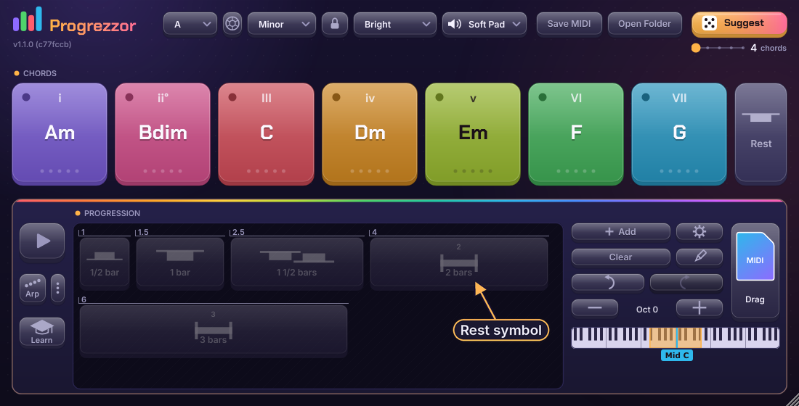

## Play, and edit while it plays

### Play

Play has two simple rules.

- **Your DAW is running:** the progression plays along with it, always. The Play button is lit and grey, and says "Your DAW is playing."
- **Your DAW is stopped:** Play starts and stops the progression on its own clock, from the first block.

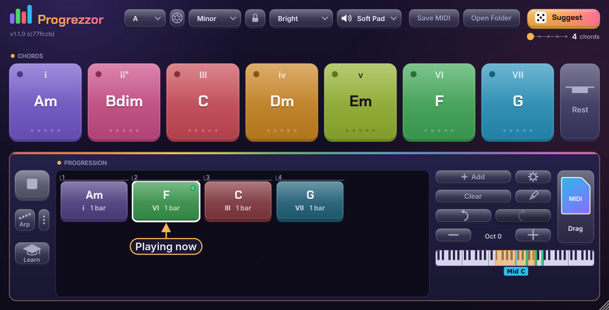

### Edit while it plays

You can change the bar at any time. A change is heard the next time the loop reaches that block, never in the middle of a chord, and nothing gets stuck. The only thing locked while it plays is the key, because a new key moves every block.

Pads, MIDI keys and clicks on blocks play on top of the progression.

### Try a chord in place

Click a block to mark it (the edge pulses). Now press a pad: instead of playing on top, the block switches to that chord with a dashed edge and the loop plays it there. Try as many pads as you like. `Enter` or a second click on the block keeps the chord. `Esc`, a click on empty background, or a click on another block puts the old chord back. Nothing is overwritten until you confirm.

### Add

Switch **Add** on and every chord you play (with the mouse or a MIDI keyboard) is put at the end of the bar as a one-bar block. That is the quickest way to jam your way to a progression. Undo removes them one at a time. It works while Play is on too: what you play is added at the end, and the loop takes it in next time round.

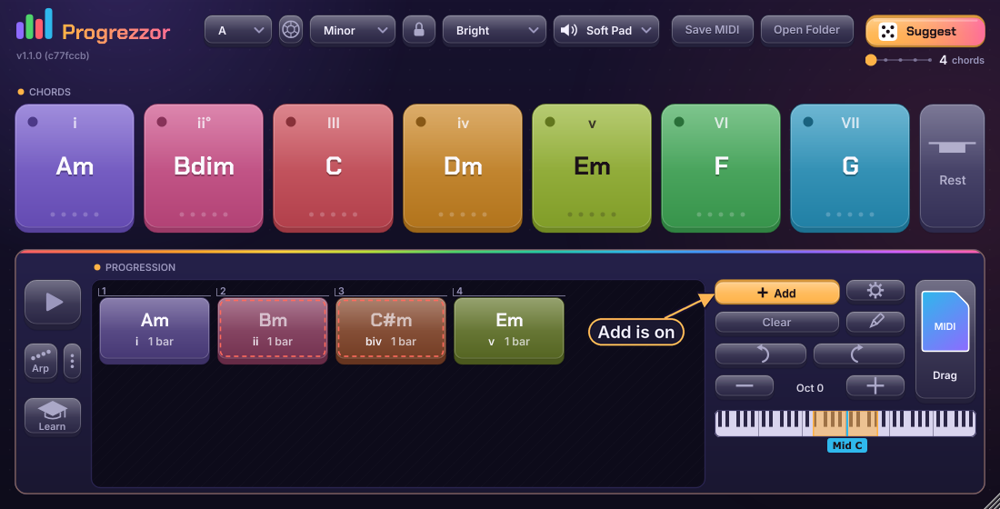

## Arp and Rhythm

The **Arp** button under Play turns it on and off. When it is on, everything is played that way: pads, MIDI keys, clicks on blocks, the loop, and the MIDI file you drag out (the file name gets "-Arp" or "-Rhythm"). The three dots beside it open the settings.

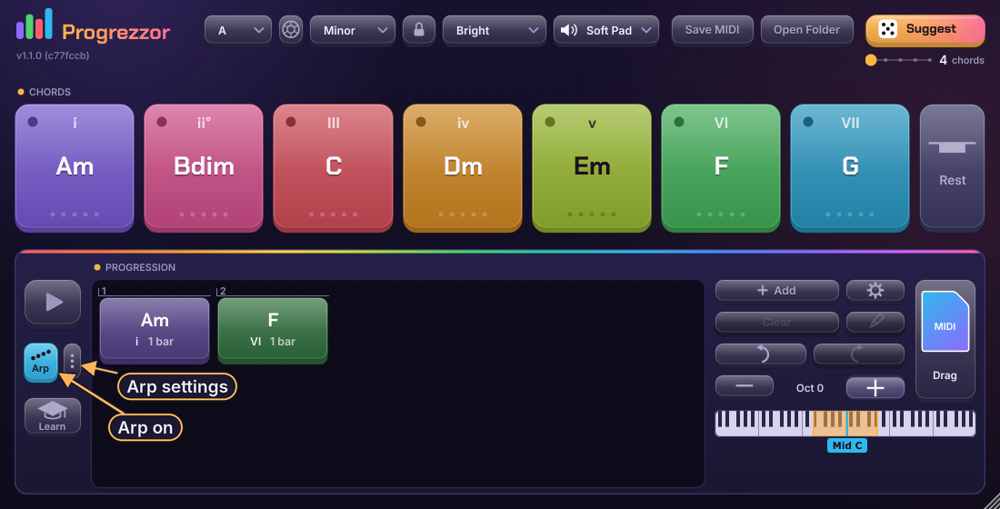

The switch at the top of the panel has three choices: **Hold** (whole chords, as normal), **Arp** and **Rhythm**.

### Arp

Plays the notes of the chord one at a time. Choose the *pattern* (Up, Down, Up/Down, Random), the *speed* (four steps), and the *rhythm* ring. The ring has dots: the lit ones play, and you can turn it with the mouse. Presets: Even, Offbeat, Gallop, Spread. You also set how many notes and steps, and one or two octaves.

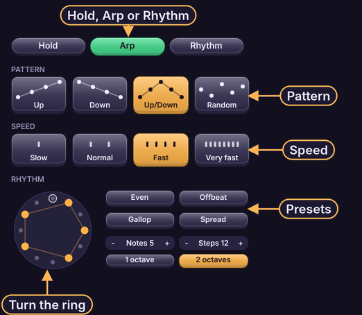

### Rhythm

Strikes the whole chord in a pattern. There are 12 to choose from: Offbeat, Stab, Double stab, Skank, Eighths, Push, Gallop, Charleston, Tresillo, Clave, Pulse and Euclid. Pick the speed (1/8 or 1/16) and the length of each strike (Short, Medium, Long). The strip at the bottom shows the pattern.

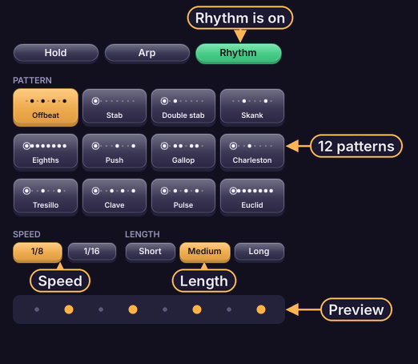

The patterns follow your DAW's timeline and start again on every block. The MIDI file has exactly the same notes as you hear.

## Quick-text

Press the pencil. The bar turns into a line of text with the current chords. Type or paste chords, press `Enter` to use them or `Esc` to cancel. The text changes the progression only, never the seven pads.

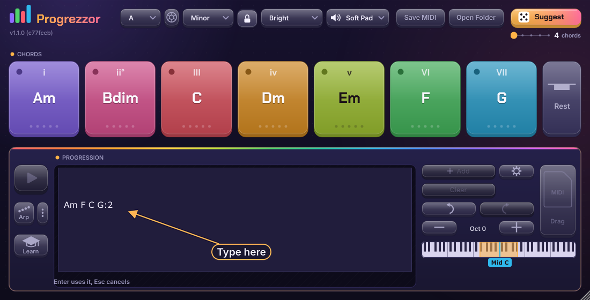

A word that is not a chord is marked in red and explained. The rest still works.

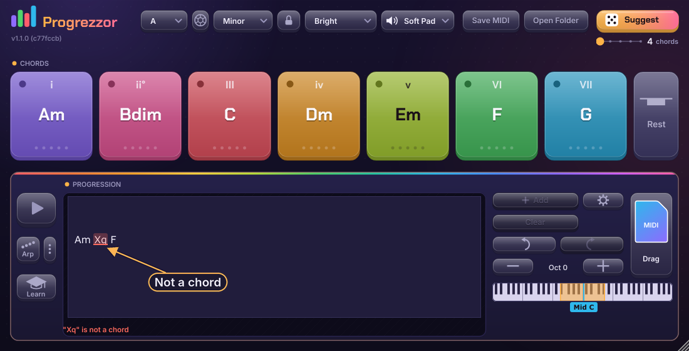

| Write | You get |
| --- | --- |
| `Am` | One block, 1 bar |
| `Am*2` | Two blocks of 1 bar (Am Am) |
| `Am:2` | One block, 2 bars |
| `Am:0.5` | One block, half a bar |
| `Am:0.5*2` | Two blocks of half a bar |
| `R`, `R:2`, `Rest*2` | A pause, with the same length and count rules |
| `G/B`, `C+1` | An inversion, or one octave up |
| `\| C \| Am \| F G \|` | Bar by bar. Two chords in one bar share it. `%` or `/` repeats the last chord. |

Remember: `*` means how many, and `:` means how long. When you open Quick-text again, it always shows the bar by bar form, so what you see is exactly what you have.

### Chords outside the key

With Lock to scale on, a chord that does not fit becomes a marked, silent block. A short message with an **Allow** button lets you switch the lock off, so the chord plays at once.

## Import and export

Both are in Settings under *Import and export*.

### Import ChordPro

**Import ChordPro...** opens a file (`.cho`, `.chopro`, `.crd`, `.pro`) and reads the chords in [square brackets]. It is a helper, not a guarantee. The chords do *not* go straight into the bar: they appear as Quick-text first, so you can check them. Press `Enter` to use them or `Esc` to cancel. A short note tells you what was skipped.

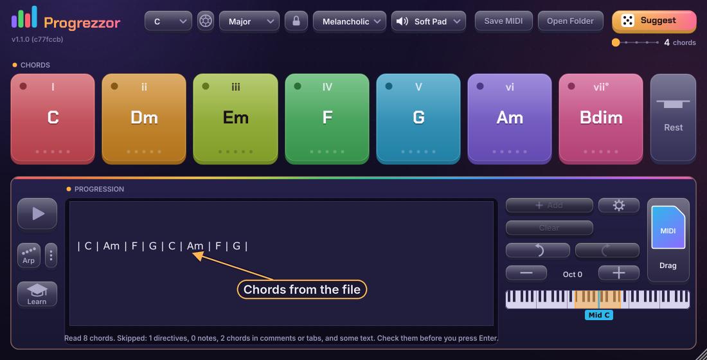

If the file says which key the song is in, Progrezzor asks and never changes the key by itself. Switching keeps the same chords.

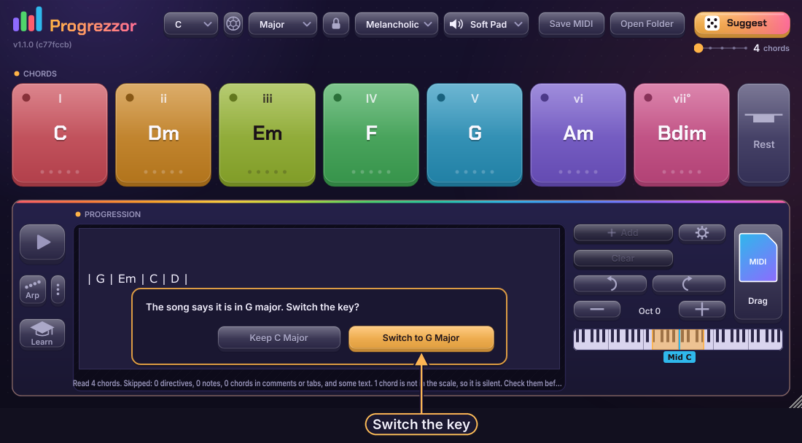

### Guessing the key

When you enter chords with Quick-text, Progrezzor looks at them and may offer a key that fits. It always asks, and nothing changes until you press Switch.

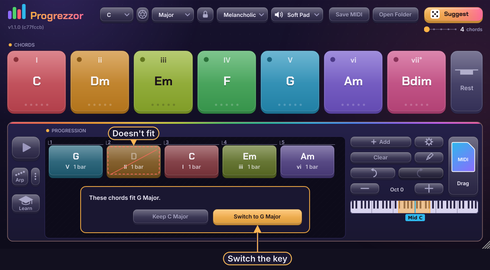

### Export as text

- **Copy as text** puts the progression on the clipboard in the bar by bar form, like `| C | Am | F G | G |`. Paste it back into Quick-text and you get exactly the same progression.
- **Save ChordPro...** saves a `.cho` file with the title, the key and the chords as a grid, with lengths kept.

Both are greyed out when the bar is empty.

## Learn

Learn is for playing the real chords on a MIDI keyboard. It needs a MIDI keyboard, because clicking pads does not count. Press **Learn** and the next chord in the bar is marked with a pulsing edge and a small arrow. The heading tells you which chord to play ("Play Am on your keyboard").

- Hold all the notes of the chord at the same time. Any octave, any order, and any inversion counts. An extra note makes it wrong.
- Right: the block gets a green tick, and the goal moves on. Let go of the keys before the next chord.
- Wrong: the block gets a red edge for a moment.
- After two wrong tries the hint appears: a small keyboard with the keys to hold, in pink with note names. The keys you hold are green (right) or blue (not in the chord). You can show hints from the start in Settings.
- It waits for you. There is no tempo, no loop and no arp while Learn is on.

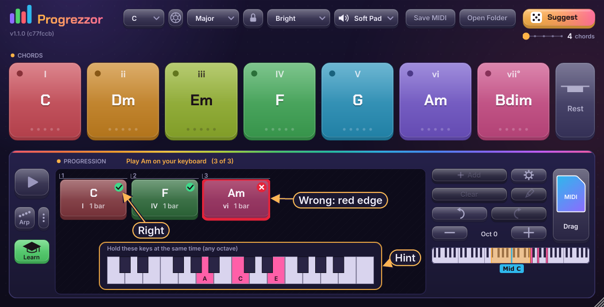

## Chord wheel

The small wheel icon next to the key opens a circle. The chords of your key are lit in the same colours as the pads. The wheel shows how chords sit next to each other, so it is a good place to look for the next chord. Click a chord to hear it. Click the icon again to close it.

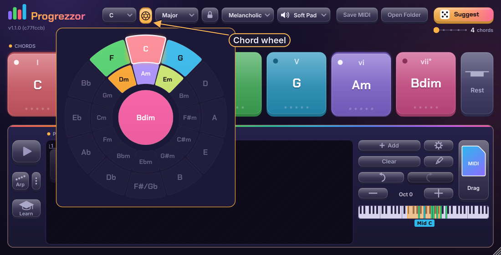

The wheel follows the key and scale (here D Phrygian).

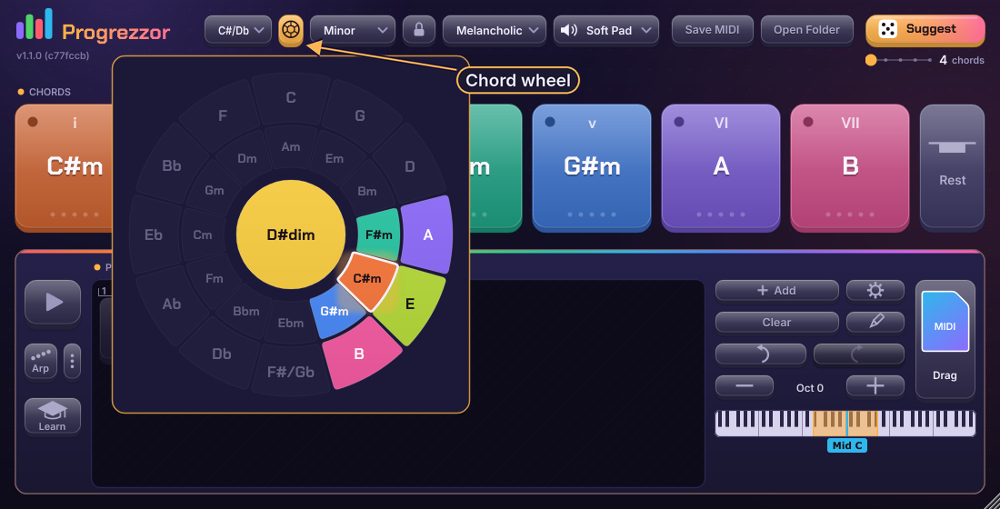

## Sound

The sound menu in the top row is the built-in preview, so you can hear what you play with no synth. The choices are Soft Pad, Piano, Strings, Keys, Organ, Stab and Pluck. The Piano uses real recorded samples.

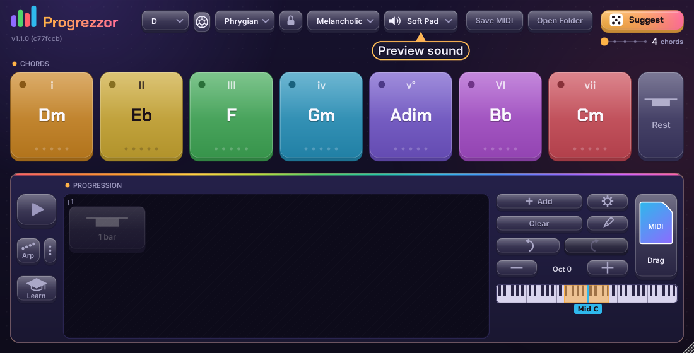

**Off** crosses out the speaker. Use it when another synth plays the MIDI.

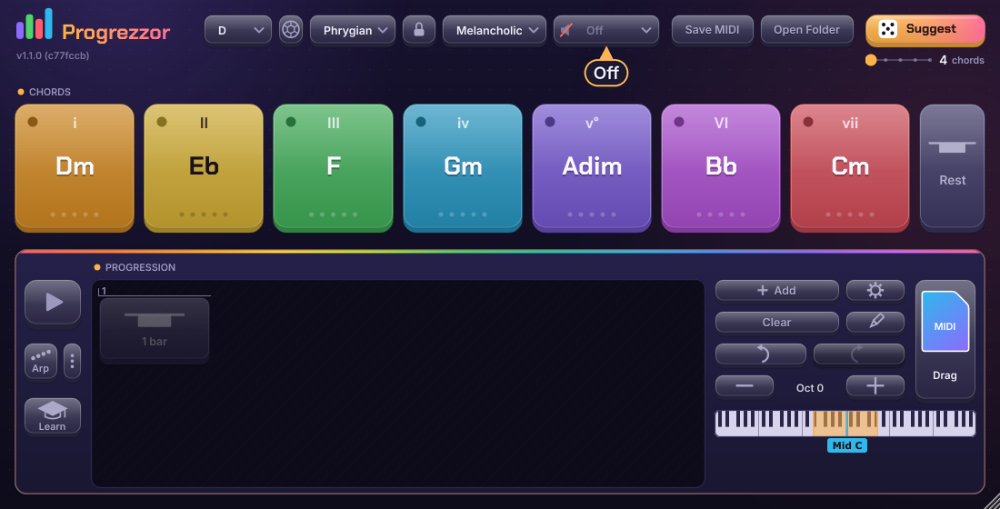

If your DAW already has a synth after Progrezzor, choose **Off**, or you will hear both.

## Settings

Open it with the gear. Most things are saved with your project. The ones marked "all projects" are kept for every project.

| Item | What it does |
| --- | --- |
| Show tooltips | Short help when you point at a button. On from the start. All projects. |
| The chords usually sit | Where the chords are: normal (around middle C), up to two octaves lower or higher. The mini keyboard shows where. All projects. The Oct buttons add to this. |
| Import ChordPro... | Read the chords from a file. See [Import and export](#import-and-export). |
| Copy as text / Save ChordPro... | Get the progression out as text. |
| Voicing | *Root position* plays every chord the same way each time. *Nearest inversion* keeps each chord close to the home chord, like a keyboard player keeping the hand in one place. The chord name does not change. |
| Keyboard | *White keys* or *Chord roots*. See [Pads](#pads). |
| Show hints from the start | Learn shows the keyboard hint right away. All projects. |
| Inversions in suggestions | On from the start. Off means Suggest gives plain chords only. All projects. |
| Bass note | Off from the start. On adds one low note under every chord, in pads, loop and MIDI file. |
| Preview sound | A tick to switch the built-in sound off and on. |
| About Progrezzor... | Version, credits and a Licences button with all third-party notices. |

The version number is also shown in small text under the logo.

## Into your DAW

### Drag the MIDI

Drag the **MIDI** tile from the bottom right into a track in your DAW. The file has exactly the notes you hear, including arp or rhythm if they are on. If that does not work in your DAW, press **Save MIDI** (the button says Saved when it is done) and **Open Folder** to find the file. The file name holds the chords, like `Am-F-C-G.mid`. The file is kept, so your DAW can read it later.

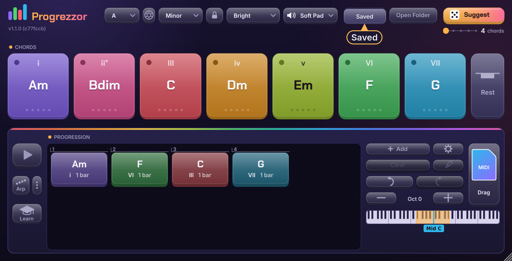

If the progression starts or ends with a rest, the file also has a silent controller (number 119) at the first and last moment, so your DAW keeps the rest in the clip. It makes no sound, and you can delete it.

### Getting the notes to your synth

Progrezzor makes MIDI, and a synth plays it. Set Progrezzor's sound to **Off** when a synth plays.

- **Bitwig Studio:** use the CLAP version. Put Progrezzor before the synth on the same track.
- **REAPER:** put Progrezzor first in the track's FX chain and the synth after it.
- **Ableton Live:** put Progrezzor (VST3) on its own MIDI track. On the synth's track, set *MIDI From* to the Progrezzor track and Monitor to *In*.
- **FL Studio:** FL only tells a plug-in that it is playing when the track has a clip in the playlist. Put any clip on it (an empty one is enough), or use Progrezzor's own Play button.

**After you drag the MIDI into your DAW,** bypass Progrezzor on that track. Otherwise the progression plays twice.

## Good to know

- **Two blocks, two strikes.** Two blocks with the same chord strike it twice. For one long chord, make one longer block.
- **Nothing sticks.** Notes always stop when you let go, when the DAW stops, when you bypass the plugin and when you close it.
- **Everything is saved** with your DAW project.
- The bar holds up to 256 blocks.
- Block lengths go in steps of 2 beats, so a half bar in 3/4 cannot be set exactly.
- A capo in an imported file is not read. The chords are taken as written.

### Shortcuts

| Key | What it does |
| --- | --- |
| `Enter` | Use the Quick-text, or keep the chord you tried in a block |
| `Esc` | Cancel Quick-text, or put back the old chord |
| `Delete` | Delete the marked block |
| `Ctrl` + drag | Copy a block (`Option` on Mac) |

---

Progrezzor is free software under the GNU Affero General Public License v3. Chakra Petch and Inter are used under the SIL Open Font License. The Piano sound uses CC0 samples from the Versilian Community Sample Library. All third-party licences are in the plugin (Settings, About, Licences).
